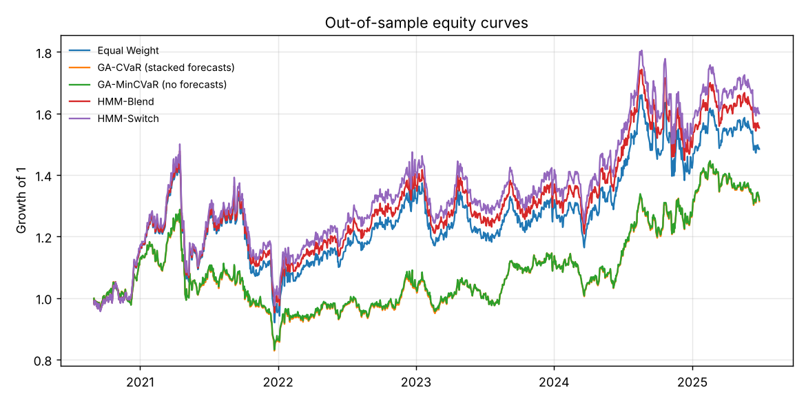
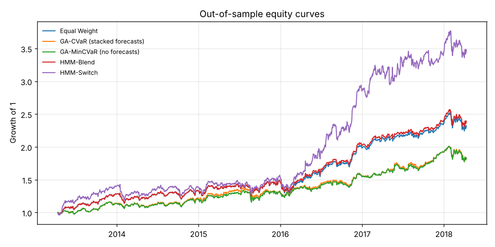

# portfolio-optimization

Long-only portfolio construction with a **genetic algorithm under a 95% CVaR objective**, fed by **Random Forest, XGBoost and stacked** return forecasts, and benchmarked against **HMM regime-switching** strategies over a **5-year out-of-sample** period.



## Pipeline

1. **Data** (`data.py`). There's no market data feed here, so the universe is simulated: 12 assets, 15 years of daily returns. The market follows a hidden 3-state Markov regime (bull / neutral / bear) with regime-specific drift and volatility. Assets load on the market and on sector factors, plus a slow persistent per-asset drift that makes trailing returns weakly predictive.
2. **Features** (`features.py`). Point-in-time momentum (5/21/63/126 days), volatility, relative momentum, rolling beta and market state. The target is the next 21 trading days' return. Tests check that changing the future never changes past features.
3. **Forecasts** (`models.py`). RF, XGBoost and a stacked ensemble (RF + XGBoost + ridge, ridge meta-learner) predict each asset's return relative to the cross-section. They are fit walk-forward, refit yearly on an expanding window, with a 21-day purge gap so no training target overlaps the forecast date.
4. **GA optimizer** (`ga.py`). Maximises `w·mu − λ·CVaR95(w)` over long-only weights capped at 30%. It uses tournament selection, blend crossover, Gaussian mutation, a projection step that repairs constraints, and elitism. CVaR scenarios are overlapping 21-day returns over the last two years.
5. **GA tuning** (`tune_ga.py`). A grid over population size × crossover rate × mutation rate at an equal budget of fitness evaluations, scored on training-period problems only.
6. **HMM benchmarks** (`hmm_strategy.py`). A Gaussian HMM fit on training-period market returns. At each rebalance the filtered regime probabilities use data up to that day only. HMM-Blend mixes risk-on / neutral / defensive portfolios by regime probability. HMM-Switch goes defensive when P(bear) > 0.5.
7. **Backtest** (`backtest.py`). Rebalances every 21 trading days, lets weights drift in between, and charges 10 bp on turnover.

## Results (out of sample, 5 years)

| Strategy | Ann. return | Ann. vol | Sharpe | Max drawdown | Daily CVaR 95% |
| --- | --- | --- | --- | --- | --- |
| Equal Weight | 8.22% | 20.80% | 0.48 | -37.18% | 3.12% |
| GA-CVaR (stacked forecasts) | 5.61% | 16.84% | 0.41 | -35.53% | 2.39% |
| GA-MinCVaR (no forecasts) | 5.68% | 16.86% | 0.41 | -35.37% | 2.40% |
| HMM-Blend | 9.22% | 20.85% | 0.53 | -35.59% | 3.09% |
| HMM-Switch | 9.86% | 21.38% | 0.55 | -35.01% | 3.16% |

Forecast quality, as mean cross-sectional rank IC out of sample: stacked 0.042, RF 0.015, XGBoost −0.027, raw 126-day momentum 0.029.

What the numbers say:
- The GA does what it's asked to do. It cuts daily CVaR by about 23% and volatility by about 19% against equal weight. It pays for that in return, so its Sharpe ratio is lower.
- The stacked forecast has the best IC of the three models, but at λ = 1 the CVaR term dominates the objective, so the GA-CVaR and GA-MinCVaR portfolios end up nearly identical. A lower λ, or scaling forecasts up to their realised dispersion, would give the forecasts more weight.
- The HMM strategies earn the best risk-adjusted returns here. Bear regimes in this simulation are short and sharp, and the filter flags most bear days.

Full tables, including the GA tuning grid, are in [`results/summary.md`](results/summary.md).

## Results on real US stocks (out of sample, April 2013 to April 2018)

The same pipeline, unchanged, run on 12 large US stocks (AAPL, AMD, AMZN, BAC, BBY, GE, JPM, PFE, SBUX, T, WMT, XOM) with daily split- and dividend-adjusted closes from April 2003 to April 2018. The last 5 years are out of sample: 59 monthly rebalances with 10 bp costs. Prices are from the `stock_prices.csv` test file of [PyPortfolioOpt](https://github.com/robertmartin8/PyPortfolioOpt) (MIT licence).



| Strategy | Ann. return | Ann. vol | Sharpe | Max drawdown | Daily CVaR 95% |
| --- | --- | --- | --- | --- | --- |
| Equal Weight | 18.21% | 14.59% | 1.22 | -14.60% | 2.20% |
| GA-CVaR (stacked forecasts) | 12.77% | 13.57% | 0.95 | -13.91% | 1.92% |
| GA-MinCVaR (no forecasts) | 12.76% | 13.67% | 0.95 | -13.66% | 1.95% |
| HMM-Blend | 18.96% | 14.50% | 1.27 | -13.05% | 2.17% |
| HMM-Switch | 28.23% | 20.36% | 1.32 | -16.31% | 2.87% |

Forecast quality, as mean cross-sectional rank IC out of sample: RF 0.104, XGBoost 0.095, stacked −0.045, raw 126-day momentum 0.119.

What changes on real data:
- The GA still lowers risk, but by less than in simulation: daily CVaR falls about 13% and volatility about 7% against equal weight. In a strong bull market that costs about 5 points of annual return.
- Random Forest and XGBoost reach a rank IC near 0.10, but neither beats raw 126-day momentum (0.119). The stacked model is negative: its ridge meta-learner, trained on the expanding window, puts weight on the wrong base model for this period.
- HMM-Switch has the best Sharpe (1.32 vs 1.22 for equal weight), but it gets there with higher volatility and a deeper drawdown. Five years with no real bear market is a weak test of a regime model.
- Twelve stocks is a small cross-section, so the ICs are noisy. Treat these numbers as a sanity check on real prices, not as evidence of a tradable edge.

Full tables are in [`results/real/summary.md`](results/real/summary.md).

## Run

```
pip install -e ".[test]"
pytest
python -m portopt.run              # simulated market, about 10 minutes on 2 cores
python -m portopt.run --data real  # 12 real US stocks, results in results/real/
```
