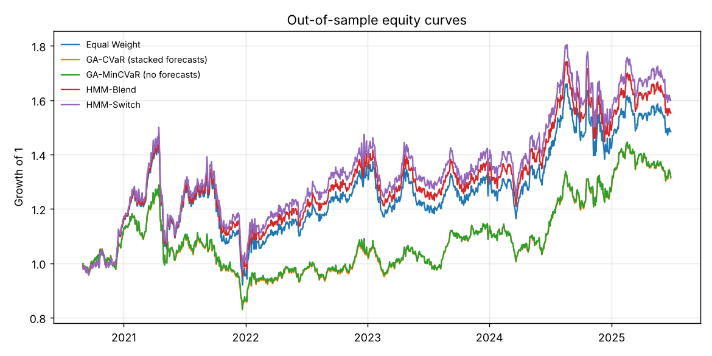

# portfolio-optimization

Long-only portfolio construction with a **genetic algorithm under a 95% CVaR objective**, fed by **Random Forest, XGBoost and stacked** return forecasts, and benchmarked against **HMM regime-switching** strategies over a **5-year out-of-sample** period.



## Pipeline

1. **Data** (`data.py`). There's no market data feed here, so the universe is simulated: 12 assets, 15 years of daily returns. The market follows a hidden 3-state Markov regime (bull / neutral / bear) with regime-specific drift and volatility. Assets load on the market and on sector factors, plus a slow persistent per-asset drift that makes trailing returns weakly predictive.
2. **Features** (`features.py`). Point-in-time momentum (5/21/63/126 days), volatility, relative momentum, rolling beta and market state. The target is the next 21 trading days' return. Tests check that changing the future never changes past features.
3. **Forecasts** (`models.py`). RF, XGBoost and a stacked ensemble (RF + XGBoost + ridge, ridge meta-learner) predict each asset's return relative to the cross-section. They are fit walk-forward, refit yearly on an expanding window, with a 21-day purge gap so no training target overlaps the forecast date.
4. **GA optimizer** (`ga.py`). Maximises `w·mu − λ·CVaR95(w)` over long-only weights capped at 30%. It uses tournament selection, blend crossover, Gaussian mutation, a projection step that repairs constraints, and elitism. CVaR scenarios are overlapping 21-day returns over the last two years.
5. **GA tuning** (`tune_ga.py`). A grid over population size × crossover rate × mutation rate at an equal budget of fitness evaluations, scored on training-period problems only.
6. **HMM benchmarks** (`hmm_strategy.py`). A Gaussian HMM fit on training-period market returns. At each rebalance the filtered regime probabilities use data up to that day only. HMM-Blend mixes risk-on / neutral / defensive portfolios by regime probability. HMM-Switch goes defensive when P(bear) > 0.5.
7. **Backtest** (`backtest.py`). Rebalances every 21 trading days, lets weights drift in between, and charges 10 bp on turnover.

## Results (out of sample, 5 years)

| Strategy | Ann. return | Ann. vol | Sharpe | Max drawdown | Daily CVaR 95% |
| --- | --- | --- | --- | --- | --- |
| Equal Weight | 8.22% | 20.80% | 0.48 | -37.18% | 3.12% |
| GA-CVaR (stacked forecasts) | 5.61% | 16.84% | 0.41 | -35.53% | 2.39% |
| GA-MinCVaR (no forecasts) | 5.68% | 16.86% | 0.41 | -35.37% | 2.40% |
| HMM-Blend | 9.22% | 20.85% | 0.53 | -35.59% | 3.09% |
| HMM-Switch | 9.86% | 21.38% | 0.55 | -35.01% | 3.16% |

Forecast quality, as mean cross-sectional rank IC out of sample: stacked 0.042, RF 0.015, XGBoost −0.027, raw 126-day momentum 0.029.

What the numbers say:
- The GA does what it's asked to do. It cuts daily CVaR by about 23% and volatility by about 19% against equal weight. It pays for that in return, so its Sharpe ratio is lower.
- The stacked forecast has the best IC of the three models, but at λ = 1 the CVaR term dominates the objective, so the GA-CVaR and GA-MinCVaR portfolios end up nearly identical. A lower λ, or scaling forecasts up to their realised dispersion, would give the forecasts more weight.
- The HMM strategies earn the best risk-adjusted returns here. Bear regimes in this simulation are short and sharp, and the filter flags most bear days.

Full tables, including the GA tuning grid, are in [`results/summary.md`](results/summary.md).

## Run

```
pip install -e ".[test]"
pytest
python -m portopt.run     # about 10 minutes on 2 cores; forecasts are cached in results/
```
